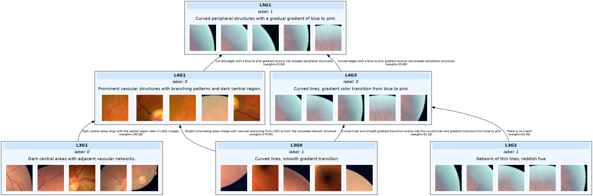

> # **NeurFlow: Interpreting Neural Networks through Neuron Groups and Functional Interactions (ICLR 2025)**
> A framework that examines groups of critical neurons and their functional interactions that significantly influence model behavior.
> 
> ## **Table of Contents**
> - [Installation](#installation)
> - [Usage](#usage)
> - [Troubleshooting](#troubleshooting)
> - [License](#license)
> 
> ## **Installation**
> 
> ### **1. Clone the Repository**
> ```bash
> git clone https://github.com/tue147/neurflow.git
> cd neurflow
> ```
> 
> ## **Usage**
> 
> ### **1. Make the result directory**
> 
> ```bash
> mkdir -p results
> ```
> 
> ### **2. Create conda environment**
> 
> ```bash
> conda env create --name neurflow --file=environments.yml
> ```
> 
> ### **3. Run the framework**
> 
> ```bash
> cd scripts
> bash run.sh
> ```
> ### **4. Visualize the result**
> 
> Open notebooks for applications.
> ```
> neurflow/
> │── notebooks/   
>     │── Debug_model.ipynb
>     │── Explaining_concept.ipynb
>     │── Visualizing_circuit.ipynb
> ```
>
>
> ## **Troubleshooting**
>
> ### **1. Environment setup error**
>
> If you can't download choldate using environment.yml or `pip install git+git://github.com/jcrudy/choldate.git`:
> - Try:
> - ```bash
>   git config --global url."https://".insteadOf git://
>   pip install git+git://github.com/jcrudy/choldate.git
>   ```
> 
> ## **License**
> 
> This repository is licensed under the [MIT License](LICENSE).

🚨 **Note**: The section above was part of the original NeurFlow repository. My updates begin after the separator.
***

# XAI: Visual Concept Hierarchy Analysis  

## Original Project Description
<sub>(Provided by the original lab repository)</sub>

This project explores explainability in neural networks by analyzing intermediate concept representations across multiple layers.  
The goal is to visualize and understand feature evolution and semantic alignment across feature maps and neuron groups.

---

## Additional Notes by Contributor

**Contributor**: [Dong-You (Sam) Jhong](https://github.com/sam31046)  
**Date**: April 30, 2025  
**Affiliation**: ECE Graduate Student, University of Florida

---

## My Contributions

- Refactored legacy code using `@dataclass` for better structure, traceability, and metadata encapsulation.
- Developed a `TopConceptsResult` schema to standardize the return values and internal metadata flow.
- Designed and implemented a `LLMGroupParser` to parse LLM outputs and structure data into:
  - `group_hierarchy.json`
  - `group_metadata.json`
  - `feature_evolution.json`
  - `feature_weights.json`
  - `group_captions.json`
- Created an image-based tree visualization module using **Graphviz** with:
  - Node-level thumbnails (horizontal layout)
  - Feature descriptions
  - Evolution relationships with weight annotations
- Extended the existing `NeurFlow` framework to support medical imaging explainability, including:
  - New pipeline integration for **Diabetic Retinopathy (DR)** classification tasks
  - Demonstrated application potential using **UK Biobank (UKB)** dataset
- Added `.gitignore` to exclude temporary, debug, or large model files from version control.

---

## Visualization Output

The script `notebooks/draw_json.ipynb` creates a tree diagram showing parent-child relationships between concept groups.  
Each node includes:

- The group name (e.g., `L5G1`)
- Description parsed from LLM
- Optional semantic label
- Thumbnails (up to 5 images per group)

Each edge includes:

- Evolution description
- Associated weights

Diagram output sample:  
  

---

## How To Run

#### 1. After training your own ResNet or other models, you need to create a new `run.sh` under `scripts` folder. To execute:    
```bash
cd scripts
bash run.sh
```
**See `models` directory for more training scripts.**

#### 2. At `notebooks/dr_Explaining_concept.ipynb`, modify these lines to match your result directory and model:
```python
directory = "../results_resnet50_DR_5class"
model_name = "resnet50_DR_5class"
```
Run the notebook, `visualizations` and some json folders will be created.

#### 3. At `notebooks/draw_json.ipynb`, modify `root_dirs` to match your json directories and run the notebook:
```python
root_dirs = ["L5G1_L4G1_L4G3_json", "L4G1_L3G0_L3G1_json", "L4G3_L3G0_L3G2_json"]
```

#### 4. The tree diagram will be saved as `concept_tree.png`.  

---

## Compatibility Patch for NeurFlow & UF HiPerGator

If you're using the original [**NeurFlow** repository](https://github.com/tue147/neurflow) or running this project in the **UF HiPerGator** HPC environment, a compatibility and setup guide is provided to help you:

📄 **[NeurFlow Installation and Patch Instructions](./docs/neurflow_patch.md)**  
*(Written by Dong-You Jhong, Feb 2025)*

This document covers:

- Conda environment setup on HiPerGator
- Torch/CUDA version alignment and installation
- Circular import resolution between `utils.py` and `NeurFlow.py`
- Dataset folder structure and validation label issues
- Safe API key usage with `.env.secret`
- Notebook-level kernel and import fixes
- How to bypass token limitations in OpenAI API responses

> ⚠️ Please follow this guide if you're porting the code to NeurFlow base or HiPerGator—some low-level compatibility issues are not handled by default.

---
